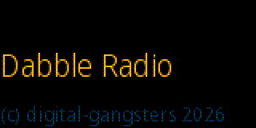

# Dabble Radio



A DAB radio project based on a Raspberry Pi, RTL-SDR, a small LCD, and rotary encoders. The core software is based on the excellent work of `dablin` and `eti-stuff` and is currently a work in progress.

This project is designed to run on **Raspberry Pi OS Lite**. While the hardware could potentially run on other systems using I2C and I2S, it has only been tested on the Pi.

## 🚀 Features

- **DAB and DAB+ Reception**: High-quality digital radio.
- **Dynamic Display**: Station name scrolling, ensemble details, and DAB type.
- **AirPlay Integration**: Stream audio via Apple Airplay with Album, Track, and Artist display.
- **Visualizations**:
  - Graphic equalizer (works in both Radio and Airplay modes).
  - CQT-based bar mode for music-responsive visualization.
  - FFT and MEL-based full visual equalizer for efficient, high-density data display.
- **Hardware Controls**:
  - Left Encoder: Station selection and menu navigation.
  - Right Encoder: Volume control and mode selection.
- **Automatic Switching**: Automatically switches to AirPlay when a stream is detected and returns to Radio when the stream stops.
- **Power Management**: Dedicated power button for on/off functionality.

---

## 🛠 Hardware

### Components
- **Raspberry Pi 5** (Pi Zero 2 was tested but lacked sufficient power for visualizations).
- **[Pimoroni 0.96" LCD](https://shop.pimoroni.com/products/0-96-spi-colour-lcd-160x80-breakout)**.
- **2 x [Fermion EC11 encoders](https://thepihut.com/products/fermion-ec11-rotary-encoder-module-breakout)**.
- **NESDR Nano 2+** (or any compatible RTL-SDR).
- **USB Sound Card** (Tecknet or similar).
- **Aerial**: 1m, 7-section with BNC connector + BNC Female to MCX Male Lowloss Pigtail (24cm).

### Build & Wiring
- **Wiring**: See the [GPIO PIN layout](docs/pin_usage.md).
- **Enclosure**: TBD.

---

## 🏃 Quick Start (Running)

If the system is already built and configured:

1. Enter your development directory.
2. Start the MQTT broker: `./run-mqtt.sh`
3. Run the radio application: `uv run radio.py`

The system will start in the last used mode (default is Radio mode).

---

## 🏗 Installation & Setup

### 1. Base OS & Configuration
Install **Raspberry Pi OS Lite** (minimal install, no GUI).

**Enable SPI and I2C:**
```bash
sudo raspi-config nonint do_spi 1
sudo raspi-config nonint do_i2c 1
```

**Update `/boot/firmware/config.txt`:**
Add the following to enable necessary interfaces and the power button:
```text
dtparam=i2c_arm=on
dtparam=i2s=on
dtparam=spi=on
dtparam=audio=off

dtoverlay=vc4-kms-v3d,noaudio
dtoverlay=max98357a
dtoverlay=i2s-mmap

# Power button
dtoverlay=gpio-shutdown,debounce=500   
dtoverlay=gpio-led,gpio=3,label=pwrled,trigger=default-on,active_low=0 
```

**Audio Setup:**
Ensure `pipewire-pulse` is installed for audio sharing:
```bash
sudo apt install -y pipewire-pulse pulseaudio-utils
sudo reboot
```

### 2. Build Essentials
```bash
sudo apt install build-essential cmake
```

### 3. Core Radio Software

#### `dablin`
1. Install dependencies:
   `sudo apt-get install libmpg123-dev libfaad-dev libsdl2-dev libfdk-aac-dev`
2. Build from source (using the [lovemonkey257 fork](https://github.com/lovemonkey257/dablin.git) for PAD message support):
   ```bash
   sudo apt remove dablin
   git clone https://github.com/lovemonkey257/dablin.git
   cd dablin
   mkdir build && cd build && cmake ..
   make dablin && sudo cp src/dablin /usr/local/bin/
   ```
   *Note: Avoid `make install` to prevent building the GTK version.*

#### `eti-cmdline`
1. Install dependencies:
   `sudo apt install libfftw3-dev libsndfile1-dev libsamplerate0-dev librtlsdr-dev libboost-dev jq`
2. Build:
   ```bash
   git clone https://github.com/JvanKatwijk/eti-stuff.git
   cd eti-stuff/eti-cmdline
   mkdir build && cd build
   cmake .. -DRTLSDR=ON
   make && sudo make install
   ```

**Test Radio Scanning:**
```bash
# Check RTL device
eti-cmdline-rtlsdr -J -x
# Acid test (Example: Magic Radio UK - tweak channel/station for your region)
dablin -D eti-cmdline -d eti-cmdline-rtlsdr -c 11D -s 0xc0c6 -I
```

### 4. AirPlay Support (`shairport-sync`)

1. **Build Dependencies:**
   ```bash
   sudo apt install -y --no-install-recommends build-essential git autoconf automake libtool libpopt-dev libconfig-dev libasound2-dev avahi-daemon libavahi-client-dev libssl-dev libsoxr-dev libplist-dev libsodium-dev libavutil-dev libavcodec-dev libavformat-dev uuid-dev libgcrypt-dev xxd jq libpipewire-0.3-dev libspa-0.2-bluetooth python3-dbus libdaemon-dev libmosquitto-dev
   ```
2. **Install NQPTP:**
   ```bash
   git clone https://github.com/mikebrady/nqptp.git
   cd nqptp && autoreconf -fi && ./configure --with-systemd-startup && make && sudo make install
   sudo systemctl enable nqptp && sudo systemctl start nqptp
   ```
3. **Install Shairport-sync:**
   ```bash
   git clone https://github.com/mikebrady/shairport-sync.git
   cd shairport-sync
   autoreconf -fi
   ./configure --sysconfdir=/etc --with-pw --with-mqtt-client --with-soxr --with-avahi --with-ssl=openssl --with-systemd --with-airplay-2 --with-metadata --with-dbus-interface --with-dbus-test-client --with-alsa --with-pw --with-pa
   make && sudo make install
   sudo systemctl disable shairport-sync
   ```
4. **User Service Setup:**
   Create `~/.config/systemd/user/shairport-sync.service`:
   ```ini
   [Unit]
   Description=Shairport Sync - AirPlay Audio Receiver
   After=sound.target
   Wants=network-online.target
   After=network.target network-online.target

   [Service]
   ExecStart=/usr/local/bin/shairport-sync --log-to-syslog

   [Install]
   WantedBy=default.target
   ```
5. **Configuration:**
   Edit `/etc/shairport-sync.conf` to enable MQTT metadata and set the output backend to `pw` (PipeWire).
6. **Start Services:**
   ```bash
   sudo systemctl enable avahi-daemon && sudo systemctl start avahi-daemon
   systemctl --user enable shairport-sync.service && systemctl --user start shairport-sync.service
   ```

### 5. MQTT Broker
The project uses MQTT for metadata. Run the provided `run-mqtt.sh` script to deploy a Mosquitto broker via Podman.

### 6. The Dabble Application
1. Install Python dependencies:
   `sudo apt install python3-dev python3-alsaaudio python3-pyaudio`
2. Install and sync the project:
   ```bash
   git clone https://github.com/lovemonkey257/dabble.git
   cd dabble
   uv init
   uv sync
   ```

### 7. Fonts
Install the **Noto Sans** font from [Google Fonts](https://fonts.google.com/share?selection.family=Noto+Sans:ital,wght@0,100..900;1,100..900) into `/usr/share/fonts/truetype/noto`.

---

## 🕹 Usage & Interface

### Display Layout
- **Top Line**: Current Mode (Radio or Airplay).
- **Middle**: 
  - Station Name (alternates with latest PAD message).
  - Visualizer background.
  - Volume bar below the visualizer.
- **Bottom Line**: Ensemble and DAB type (standard DAB or DAB+).

**AirPlay Mode**: The display automatically updates to show Track, Artist, and Album Name.

### Controls
#### Left Encoder (Navigation & Settings)
- **Rotate**: Select a station. The station is automatically selected if left for 4 seconds.
- **Click**: Open Menu:
  - **Visualizations**: Graphic Equalizer, Waveform, Bar Graphic Equalizer.
  - **Toggles**: Levels On/Off, Visualizer On/Off, Station Name On/Off.
  - *Timeout*: Reverts to play screen after 5 seconds of inactivity.

#### Right Encoder (Volume & Mode)
- **Rotate**: Adjust volume (logarithmic scale).
- **Click**: Open Menu:
  - **Mode Select**: Radio Mode, Airplay Mode.
  - **Actions**: Scan, Standby Mode.
  - *Timeout*: Reverts to play screen after 5 seconds of inactivity.

---

## ⚙️ Configuration

The application saves state in `dabble_radio.json`. Example configuration:
```json
{
    "station_name": "Heart Dance",
    "ensemble": "D1 National",
    "volume": 34,
    "pulse_left_led_encoder": false,
    "pulse_right_led_encoder": false,
    "enable_visualiser": true,
    "visualiser": "graphic_equaliser",
    "enable_levels": false,
    "theme_name": "default"
}
```

---

## 🚩 Current Status & Roadmap

- [ ] Fix interface issues when selecting stations.
- [ ] Add ability to select country/default ensembles to scan.
- [ ] Implement a way to select and update themes.
- [ ] Configure automatic startup at boot.
- [ ] Investigate Google Cast support (likely requires proprietary protocols; potential alternative: [shanocast](https://github.com/rgerganov/shanocast)).

---

## 📜 Appendix: Deprecated Notes

### Adafruit Speaker Bonnet Capture
The Adafruit Speaker Bonnet driver is playback-only and does not provide a recording interface for the visualizer. 

**Previous Workaround (Not Recommended):**
Used `snd-aloop` and `pactl` loopback modules to route audio from the Bonnet back into a capture sink. This was complex and lacked volume control, leading to the switch to a USB sound card.
